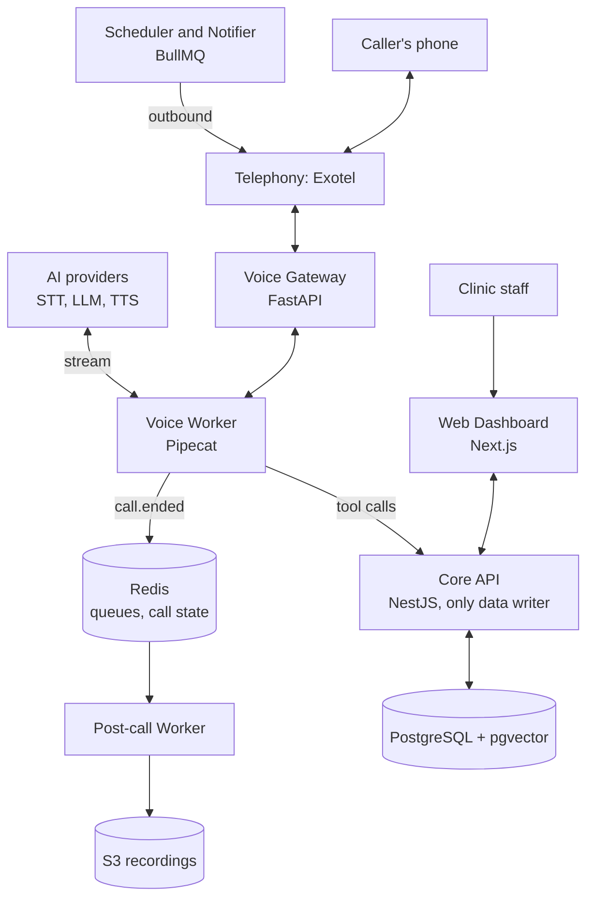

# AI Calling Agent Platform: Master Architecture

> Exported from the Master Architecture Claude Doc (2026-10-22). Edit the Claude Doc first, then re-export here.

## Product vision and MVP

A multi-tenant SaaS that gives businesses an AI voice agent that answers and makes phone calls in Indian languages. Clinics are the first vertical; the core engine stays sector-agnostic so a new vertical is a new template, not a new codebase.

**MVP (clinics only)**

- Inbound: answer calls; book, reschedule, or cancel appointments; answer FAQs from the clinic's knowledge base.
- Outbound: appointment reminders and post-visit follow-ups, run as scheduled campaigns.
- Human handoff: warm transfer to clinic staff on request, confusion, or emergency keywords.
- Dashboard: call logs, recordings, transcripts, summaries, bookings, and basic analytics.
- Post-call WhatsApp or SMS confirmation.

**Later verticals** reuse the same engine: real estate lead qualification, loan and EMI reminders, restaurant reservations, e-commerce COD confirmation.

**Out of scope for MVP:** medical advice of any kind, payments on calls, EHR deep integrations, self-serve signup.

## System architecture

Live audio moves down the centre (phone, telephony, gateway, worker) and the worker only reaches business data through Core API tool calls, so the voice side can scale or be swapped without touching data rules.

## Real-time voice pipeline

1. Exotel opens a bidirectional WebSocket media stream to the Voice Gateway.
2. Gateway assigns the call to a Voice Worker and loads the tenant's agent config (prompt, voice, language, tools).
3. Voice activity detection (Silero) marks when the caller starts and stops speaking.
4. Streaming STT (Sarvam or Deepgram) emits partial and final transcripts.
5. LLM streams a reply and may call tools (check slots, book, transfer, end call).
6. Streaming TTS (Sarvam or ElevenLabs) speaks the first sentence while the rest is still generating.
7. On barge-in, the worker cancels TTS and LLM output immediately and listens again.
8. On hangup, the worker emits `call.ended`; the post-call pipeline handles summary, analytics, and notifications.

**Latency budget (target, end of caller speech to first agent audio)**

| Stage | Target |
| --- | --- |
| End-of-turn detection | 200-300 ms |
| STT final | 100-200 ms |
| LLM first token | 300-500 ms |
| TTS first audio | 150-250 ms |
| **Total** | **under 1.2 s** |

**Design rules**

- Build on Pipecat so STT, LLM, and TTS are swappable providers behind one interface.
- Provider choice is per-tenant config, never hard-coded.
- Tools are plain Python functions calling the Core API; the LLM never touches the database directly.
- Use a filler line ("one moment, checking slots") when a tool call will take over 1 second.
- Run workers in an Indian region close to the telephony provider's media servers.

## Services

| Service | Language | Responsibility |
| --- | --- | --- |
| Web Dashboard | Next.js + TypeScript | Clinic admin UI |
| Core API | NestJS + TypeScript | Auth, tenants, agents, appointments, campaigns, billing; only writer of business data |
| Voice Gateway | Python (FastAPI) | Telephony webhooks, media WebSockets, routing |
| Voice Worker | Python (Pipecat) | Live call session |
| Post-call Worker | Python | Transcripts, summaries, outcome tags, analytics |
| Scheduler and Notifier | Node.js (BullMQ) | Campaigns, retries, calling-hours rules, WhatsApp/SMS |

Shared infrastructure: PostgreSQL (+ pgvector), Redis, S3-compatible storage.

## Data model

Every business table carries `tenant_id`, enforced with Postgres row-level security.

| Entity | Key fields | Notes |
| --- | --- | --- |
| Tenant | id, name, plan, region, settings | One clinic or business account |
| User | id, tenant_id, email, role | owner, admin, staff |
| Location | id, tenant_id, address, timezone, hours | Clinic branches |
| Provider | id, tenant_id, location_id, name, specialty | Doctor or bookable resource |
| Slot | id, provider_id, start, end, status | Unique on provider + start |
| Contact | id, tenant_id, phone, name, language, consent flags | Phone encrypted |
| Appointment | id, tenant_id, contact_id, slot_id, status, source | call, dashboard, import |
| PhoneNumber | id, tenant_id, number, provider, agent_id | Inbound number to agent |
| Agent | id, tenant_id, template, prompt, voice, language, tools, version | Versioned |
| KnowledgeDoc | id, tenant_id, title, chunks, embeddings | RAG source |
| Call | id, tenant_id, agent_version, direction, from, to, status, duration, cost | One row per call |
| CallEvent | call_id, ts, type, payload | Turns, tool calls, latency, errors |
| Transcript | call_id, turns, summary, outcome, recording_url | Signed URL on read |
| Campaign | id, tenant_id, type, schedule, contact list, rules | Reminders, follow-ups |
| UsageRecord | tenant_id, call_id, minutes, provider costs | Billing |
| AuditLog | tenant_id, actor, action, target, ts | Access trail |

## Multi-tenancy, security and compliance

Verify legal requirements with a lawyer before launch; these are the engineering controls.

- Shared database, `tenant_id` on every row, RLS as safety net; per-tenant config, rate limits, quotas.
- JWT with short-lived tokens; RBAC by role; secrets in a managed vault.
- Encryption at rest; field-level encryption for phone numbers; signed expiring URLs for recordings; access audit log.
- Verify telephony webhook signatures.
- DPDP Act: per-contact consent, export and deletion requests, retention limits, Indian-region hosting.
- Outbound: DND and calling-hours rules, opt-out list, registered numbers.
- Agent discloses it is an AI at the start of every call.
- Medical safety: no diagnosis, dosage or treatment advice; an LLM-independent emergency keyword detector triggers a fixed script plus transfer; prompt changes must pass the evaluation suite.

## Infrastructure and scaling

| Stage | Setup | When |
| --- | --- | --- |
| Local | docker-compose: Postgres, Redis, MinIO; ngrok for webhooks | Day one |
| Pilot | AWS ECS in ap-south-1; RDS Postgres, ElastiCache Redis | First 5-10 clinics |
| Production | EKS in ap-south-1; autoscaled Voice Workers; staging environment | When calls outgrow one host |

- Scale Voice Workers on active-call count; workers report capacity to Redis; Gateway routes to least-loaded.
- Workers drain gracefully on deploy.
- Core API and dashboard are stateless.
- Post-call work is async through queues.
- CI: GitHub Actions (lint, type-check, tests, images, staging on merge to `main`); production by tag with the evaluation suite as a gate; migrations as a separate reviewed step.

## Observability, testing and call quality

- One `call_id` through logs, traces and events (OpenTelemetry); per-turn latency in CallEvent, charted in Grafana; Sentry everywhere.
- Alerts: p95 latency over target, call failure rate, provider errors, worker capacity.
- Unit tests for tools and business rules; Core API integration tests against real Postgres in CI.
- Simulated calls: an LLM-driven caller runs scripted scenarios (book, reschedule, angry caller, emergency, Hinglish).
- Scenario set per vertical scored on every prompt or model change; regressions block release; weekly review of real calls.

## Roadmap

| Phase | Weeks (estimate) | Scope | Exit gate |
| --- | --- | --- | --- |
| 1 Foundations | 1-3 | Monorepo, local stack; schema, auth, tenants; telephony number; media echo test | One call answered end to end |
| 2 Voice MVP | 4-7 | STT/LLM/TTS loop; barge-in, latency logs; booking + FAQ tools; dashboard call log | 20 test scenarios pass, latency under 1.2 s |
| 3 Pilot | 8-12 | 3-5 clinics; reminder campaigns; WhatsApp confirmations; monitoring | Pilot clinics use it daily for 2 weeks |
| 4 Production | 13+ | Billing; self-serve onboarding; autoscaled workers; next vertical | |

## Conventions

- TypeScript strict; Python with type hints, ruff, mypy.
- REST with OpenAPI generated from the Core API; shared types generated from it.
- Events named `domain.action` with versioned JSON schemas.
- Times stored in UTC, displayed in the location's timezone.
- Every log line carries `tenant_id` and, during calls, `call_id`.
- Config via environment variables validated at startup; no keys in code.
- `main` is staging, tags are production; conventional commits.

## Decision log

See [`adr/`](adr/README.md).
